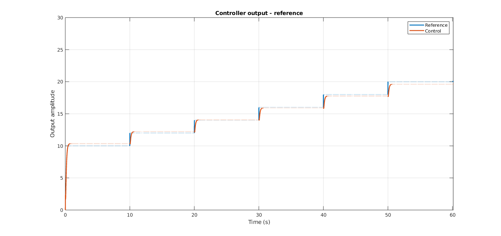
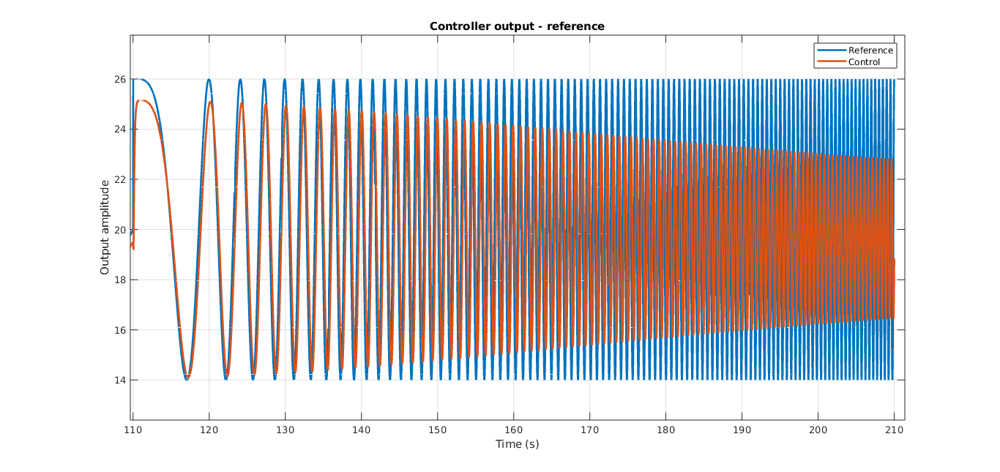

<div align="center">

# Modélisation floue et commande d'un hélicrane
## Fuzzy Modeling and Control of a Helicrane

**EN** — A MATLAB study of local fuzzy models for identifying a helicopter-like process and testing a model-based controller.

**FR** — Une étude MATLAB de modèles flous locaux pour identifier un procédé de type hélicrane et tester une commande fondée sur son modèle.



<sub>Reference and controller response in a saved step-response experiment / Consigne et réponse du contrôleur dans une simulation en échelons enregistrée.</sub>

[← Back to portfolio / Retour au portfolio](https://github.com/mlmdc) · [Contents / Sommaire](#contents)

</div>

## Contents

- [Overview / Présentation](#overview)
- [Problem & approach / Problématique & approche](#problem--approach)
- [Technical decisions / Choix techniques](#technical-decisions)
- [Results & learnings / Résultats & apprentissages](#results--learnings)
- [Getting started](#getting-started)

<a id="overview"></a>
## Overview / Présentation

**EN** — This project explores how to approximate the nonlinear input-output dynamics of a helicopter-like process (`helicrane`) and use that model in a controller. It is intended for control and system-identification coursework and experimentation, not as a deployable flight-control system. MATLAB scripts generate excitation signals, identify local models, compare fuzzy and NARX models, and simulate a fuzzy-model-based controller.

**FR** — Ce projet étudie comment approximer la dynamique non linéaire entrée-sortie d'un procédé de type hélicrane (`helicrane`), puis utiliser ce modèle dans un contrôleur. Il s'adresse à l'identification des systèmes et à l'automatique expérimentales, et non à la réalisation d'une commande de vol déployable. Les scripts MATLAB génèrent des signaux d'excitation, identifient des modèles locaux, comparent des modèles flous et NARX, puis simulent un contrôleur fondé sur un modèle flou.

**EN** — The repository brings together two connected experimental tracks: identifying and validating a nonlinear process model, then using a fuzzy state-space representation to investigate reference tracking in simulation. The first track produces model parameters and comparison plots; the second loads saved model data and evaluates a controller against the process simulation.

**FR** — Le dépôt réunit deux volets expérimentaux liés : identifier et valider un modèle de procédé non linéaire, puis utiliser une représentation floue en espace d'état pour étudier le suivi de consigne en simulation. Le premier volet produit des paramètres de modèle et des graphiques de comparaison ; le second charge des données de modèle enregistrées et évalue un contrôleur face à la simulation du procédé.

**Features / Fonctionnalités**

- **EN:** Generate PRBS, step, ramp, and chirp excitation signals and collect simulated process responses.
- **FR :** Générer des signaux d'excitation PRBS, en échelons, en rampe et en chirp, puis recueillir les réponses simulées du procédé.
- **EN:** Cluster input-output samples with Gustafson-Kessel and estimate local ARX dynamics with weighted least squares.
- **FR :** Regrouper les échantillons entrée-sortie avec Gustafson-Kessel et estimer des dynamiques ARX locales par moindres carrés pondérés.
- **EN:** Assemble a Takagi-Sugeno fuzzy model, compare it with a NARX neural-network model, and explore control in simulation.
- **FR :** Construire un modèle flou de Takagi-Sugeno, le comparer à un réseau neuronal NARX et explorer la commande en simulation.

### Project workflow / Déroulement du projet

**1. Identify and compare models / Identifier et comparer des modèles**

**EN** — Identification scripts excite the process with PRBS sequences, steps, and chirps at a fixed 0.01 s sample interval. `lab5_2.m` builds an input-output dataset over approximately 0–1.3 input units, clusters operating regions into five groups with Gustafson-Kessel, and estimates a second-order local ARX model in each region using regularized weighted least squares. The local models are combined into a Takagi-Sugeno fuzzy inference system. The script also trains a NARX network with two input delays, two feedback delays, and a 10-neuron hidden layer for comparison.

**FR** — Les scripts d'identification excitent le procédé avec des séquences PRBS, des échelons et des chirps, à un pas d'échantillonnage fixe de 0,01 s. `lab5_2.m` construit un jeu de données entrée-sortie sur une plage d'entrée d'environ 0 à 1,3, regroupe les zones de fonctionnement en cinq classes avec Gustafson-Kessel et estime un modèle ARX local du second ordre dans chaque zone par moindres carrés pondérés régularisés. Les modèles locaux sont réunis dans un système d'inférence flou de Takagi-Sugeno. Le script entraîne également un réseau NARX avec deux retards d'entrée, deux retards de rétroaction et une couche cachée de 10 neurones pour permettre la comparaison.

**2. Simulate a fuzzy-model controller / Simuler un contrôleur fondé sur le modèle flou**

**EN** — `lab6.m` loads saved fuzzy-model parameters, converts five local discrete transfer functions to state-space form, and blends their matrices according to triangular input membership functions. A first-order reference model and a receding-horizon control calculation are then evaluated in a simulation at 0.01 s per step. The requested process input is clipped to [0, 1.3]; the proposed rate-of-change limit is present in the script but commented out.

**FR** — `lab6.m` charge les paramètres enregistrés du modèle flou, convertit cinq fonctions de transfert discrètes locales en représentations d'état et combine leurs matrices selon des fonctions d'appartenance triangulaires définies par l'entrée. Un modèle de référence du premier ordre et un calcul de commande à horizon glissant sont ensuite évalués dans une simulation à 0,01 s par pas. La commande demandée au procédé est limitée à une plage de 0 à 1,3 ; la limitation proposée de sa vitesse de variation figure dans le script, mais est commentée.

<a id="problem--approach"></a>
## Problem & approach / Problématique & approche

**EN** — A single linear model is not intended to represent the process equally well across its operating range. The first assignment addresses this by using local linear dynamics, activated by fuzzy membership functions. The practical constraints are the available process simulator, a fixed sample interval, a bounded input range, and the need to compare several model structures on generated data. PRBS and other test signals provide excitation; Gustafson-Kessel clustering defines operating regions, and weighted least squares estimates one ARX model per region. A NARX network acts as a separate nonlinear baseline.

**FR** — Un modèle linéaire unique n'est pas destiné à représenter le procédé avec la même précision sur toute sa plage de fonctionnement. Le premier travail répond à ce problème avec des dynamiques linéaires locales activées par des fonctions d'appartenance floues. Les contraintes pratiques sont le simulateur disponible, un pas d'échantillonnage fixe, une plage d'entrée bornée et la nécessité de comparer plusieurs structures de modèle sur des données générées. Les signaux PRBS et autres essais fournissent l'excitation ; le clustering de Gustafson-Kessel définit les zones de fonctionnement et les moindres carrés pondérés estiment un modèle ARX par zone. Un réseau NARX sert de référence non linéaire distincte.

**EN** — The second assignment uses the identified local dynamics in a fuzzy state-space model and investigates a model-based controller. Its purpose is to connect identification with control, not to claim closed-loop safety or real-world flight performance. Input saturation is implemented; rate limiting is not active in the current script.

**FR** — Le second travail réutilise les dynamiques locales identifiées dans un modèle flou en espace d'état et étudie un contrôleur fondé sur le modèle. L'objectif est de relier l'identification à la commande, sans prétendre démontrer la sûreté en boucle fermée ni des performances en vol réel. La saturation de l'entrée est implémentée ; la limitation de sa vitesse de variation n'est pas active dans le script actuel.

<a id="technical-decisions"></a>
## Technical decisions / Choix techniques

**EN** — MATLAB was retained because the experiments rely on its control, fuzzy-logic, signal-generation, and neural-network functions, as well as the supplied `helicrane.p` process model. Gustafson-Kessel clustering uses cluster-specific covariance information to represent local data regions; weighted least squares estimates each region's linear dynamics, with a small regularization term in `lab5_2.m`. A Takagi-Sugeno structure blends local consequents, while a NARX network provides an independent model family for comparison. For control, state-space models allow the local dynamics to be combined in the simulation loop. The code is organized as research scripts rather than a packaged application, which keeps experiments direct but leaves execution order and dependencies implicit.

**FR** — MATLAB a été retenu car les expériences s'appuient sur ses fonctions de commande, logique floue, génération de signaux et réseaux neuronaux, ainsi que sur le modèle de procédé fourni sous forme de fichier `helicrane.p`. Le clustering de Gustafson-Kessel tient compte de la covariance propre à chaque classe pour représenter les zones locales ; les moindres carrés pondérés estiment leur dynamique linéaire, avec une faible régularisation dans `lab5_2.m`. Une structure de Takagi-Sugeno combine les modèles locaux, tandis qu'un réseau NARX fournit une famille de modèles indépendante pour la comparaison. Pour la commande, la représentation en espace d'état permet de combiner les dynamiques locales dans la boucle de simulation. Le code prend la forme de scripts de recherche plutôt que d'une application empaquetée : les expériences restent directes, mais l'ordre d'exécution et les dépendances sont peu explicités.

<a id="results--learnings"></a>
## Results & learnings / Résultats & apprentissages

**EN** — The repository includes plots from clustering, local-model, step, and chirp experiments. In the saved step-response plot, the controller output follows the plotted reference across several levels. In the chirp plot, the difference between reference and control becomes more visible as the excitation frequency rises. These figures provide qualitative evidence only: the scripts do not report a consistent aggregate error metric, and the plotted saved results do not identify the exact parameter set or run that produced them.

**FR** — Le dépôt contient des graphiques de clustering, de modèles locaux et d'expériences en échelons et en chirp. Sur le graphique enregistré en échelons, la sortie du contrôleur suit la référence affichée à plusieurs niveaux. Sur le graphique en chirp, l'écart entre référence et commande devient plus visible à mesure que la fréquence d'excitation augmente. Ces figures ne fournissent qu'une indication qualitative : les scripts ne calculent pas de métrique d'erreur agrégée commune et les graphiques enregistrés ne précisent pas le jeu de paramètres ni l'exécution qui les a produits.

<p align="center">
  
</p>

<sub>Chirp simulation: the response diverges increasingly from the reference at higher frequencies / Simulation en chirp : la réponse s'écarte davantage de la consigne aux fréquences élevées.</sub>

**EN** — The experiments show how local models can represent different operating regions, and why good step tracking alone does not establish fidelity under faster-changing inputs. Reproducibility is limited by randomized data or initialization without a shared random seed, the protected `helicrane.p` implementation, no declared MATLAB/toolbox version matrix, no automated test suite, and scripts that mix identification, training, plots, and control experiments. In `lab6.m`, the reference signal is scaled by 10 while the process command is clipped to [0, 1.3]; this makes the signal scaling and interpretation of the controller plots important to verify before drawing quantitative conclusions. Useful next steps are to document a known-good MATLAB setup, separate experiment stages, make runs repeatable, and report numerical validation metrics on fixed test signals.

**FR** — Les expériences montrent comment des modèles locaux peuvent représenter différentes zones de fonctionnement, et pourquoi un bon suivi en échelons ne suffit pas à établir la fidélité sur des entrées plus rapides. La reproductibilité est limitée par des données ou initialisations aléatoires sans graine commune, l'implémentation protégée de `helicrane.p`, l'absence de versions MATLAB et de boîtes à outils documentées, l'absence de tests automatisés et des scripts qui mélangent identification, apprentissage, graphiques et essais de commande. Dans `lab6.m`, le signal de référence est multiplié par 10 alors que la commande du procédé est limitée à une plage de 0 à 1,3 ; il convient donc de vérifier l'échelle des signaux et l'interprétation des graphiques avant toute conclusion quantitative. Les suites utiles seraient de documenter une configuration MATLAB vérifiée, de séparer les étapes expérimentales, de rendre les exécutions reproductibles et de publier des métriques numériques sur des signaux de test fixes.

<a id="getting-started"></a>
## Getting started

### Requirements

- MATLAB. No minimum release is documented.
- The supplied `helicrane.p` MATLAB P-code file, required by the process simulations. Its implementation is protected and is not included as editable source.
- For the full experiments, MATLAB toolboxes providing the functions used by each script: Fuzzy Logic Toolbox, Control System Toolbox, Signal Processing Toolbox, and Deep Learning Toolbox (`narxnet`). `gscatter` in the clustering scripts may also require Statistics and Machine Learning Toolbox. The simple example below only calls the supplied process model.

There is no package installer or shared configuration file. Run scripts from the repository root so MATLAB can find the model, data, and helper files.

### Run a process simulation

```matlab
addpath(pwd)
run('primer_uporabe_helicrane.m')
```

This example applies a varying input to the process for 2,000 iterations at the script's fixed 0.01-second sample time, then plots the output. For the broader identification, fuzzy-model, and NARX experiments, run `lab5_2.m`. The archived-data scripts `gk.m` and `lab6.m` use `ident_data.mat` and `fuzzy_data.mat`, respectively.

### Choose an experiment

| Goal | Script | Notes |
| --- | --- | --- |
| Simulate the process | `primer_uporabe_helicrane.m` | Short example; requires `helicrane.p`. |
| Identify models and compare fuzzy/NARX responses | `lab5_2.m` | Generates excitation and trains models; opens MATLAB figures. |
| Explore clustering and saved identification data | `gk.m` | Loads `ident_data.mat`; includes Gustafson-Kessel clustering and local-model estimation. |
| Simulate fuzzy-model control | `lab6.m` | Loads `fuzzy_data.mat`; requires saved local-model parameters and `helicrane.p`. |
| Inspect alternate mapping/identification experiments | `mapping_curve.m`, `lab5.m`, `backup.m` | Research scripts and variants; not packaged command-line tools. |

`lab5_2.m` and `lab6.m` are not a parameter-free pipeline: the former computes model variables in the MATLAB workspace, while the latter expects compatible model variables in `fuzzy_data.mat`. Confirm that the saved data corresponds to the model and variable names expected by the script before running the control experiment. `narxNet.mat` is a saved network artifact; the README does not assume it is used by every workflow.

### Repository map

- `primer_uporabe_helicrane.m` — minimal process simulation example.
- `lab5.m`, `lab5_2.m` — identification, Gustafson-Kessel clustering, local ARX estimation, fuzzy modeling, and NARX experiments.
- `lab6.m` — fuzzy state-space model and controller simulation.
- `gk.m`, `mapping_curve.m`, `backup.m` — clustering, model-identification experiments, and working variants.
- `prbs.m` — PRBS signal generator.
- `ident_data.mat`, `fuzzy_data.mat`, `narxNet.mat` — saved MATLAB data and model artifacts used by selected scripts.
- `medias/` — plots and reference documents.
